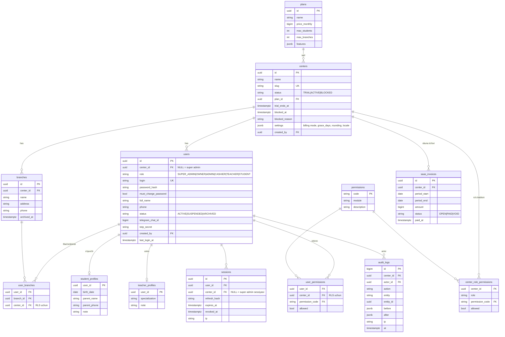
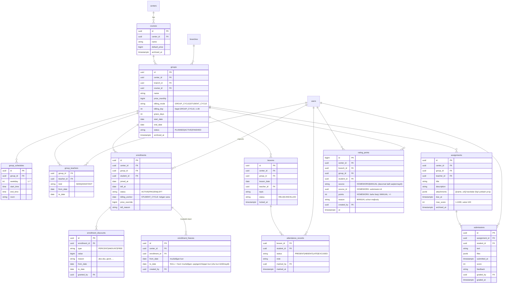
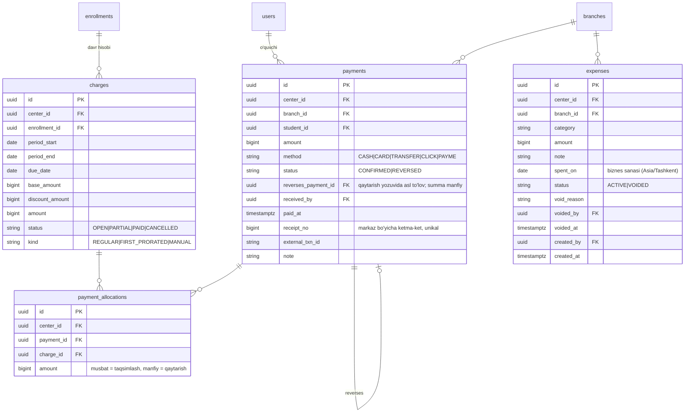

# ERD va ruxsatlar matritsasi (1-versiya)

Asos: [REJA.md](REJA.md). Bu hujjat loyihaning ma'lumotlar modeli va kirish huquqlarini belgilaydi. Mermaid diagrammalarni VS Code (Markdown Preview Mermaid Support) yoki GitHub'da ko'rish mumkin.

## 1. Asosiy dizayn qoidalari

1. **Tenant = `centers`.** Super admin dan tashqari barcha `users` bitta markazga tegishli. Tenant ma'lumotini o'z ichiga olgan har bir jadvalda `center_id` bor, filialga bog'liq jadvallarda `branch_id` ham.
2. **Tenant izolyatsiyasi:** PostgreSQL RLS (`center_id = current_setting('app.center_id')`) + servis darajasida ikkinchi tekshiruv. Super admin siyosati alohida (faqat `centers`, `users(role=OWNER)`, `plans`, `saas_*`).
3. **Pul append-only:** `payments`, `payroll_payouts`, `audit_logs` o'chirilmaydi/tahrirlanmaydi. Xato bo'lsa teskari yozuv (`reversal`) qo'shiladi.
4. **Qarz saqlanmaydi, hisoblanadi.** Rejalashtiruvchi (cron) har davr uchun `charges` (hisob-kitob yozuvi) yaratadi; qarz = to'lanmagan `charges` bo'lib, `due_date + grace_days` o'tgan.
5. **Pul turi:** butun son (so'm), `bigint`. Foiz hisobida yaxlitlash qoidasi markaz sozlamasida.
6. **Yumshoq o'chirish:** `archived_at` ustuni; o'quvchi/guruh/ustoz haqiqatan o'chirilmaydi (hisobotlar va qarz tarixi saqlanadi).
7. **Har markaz ko'p filialli, faqat hali bitta filial bor.** Markaz yaratilganda avtomatik "Asosiy filial" ochiladi; filialga bog'liq jadvallarda `branch_id` doim `NOT NULL`. Interfeysda filial bitta bo'lsa filial tanlovi yashiriladi, ikkinchisi ochilganda hech narsa qayta qurilmaydi.
8. **Ruxsatlar:** rol + markaz sozlamasi + foydalanuvchi bo'yicha istisno. Kod ichida qattiq ruxsat kodlari ro'yxati.

## 2. ERD

### 2.1. Tenant, filial, foydalanuvchi va ruxsatlar

Izohlar:
- **Kassir/admin birlashishi:** alohida rol turi saqlanadi (`ADMIN`, `CASHIER`), lekin `center_role_permissions` va `user_permissions` orqali admin kassir ruxsatlarini ham olishi mumkin. Shunda "kassir yaratmaslik" holati faqat sozlama bo'ladi.
- **Filialga bog'lash:** `OWNER` barcha filialni ko'radi; `ADMIN`/`CASHIER` faqat `user_branches` dagi filiallarni. `TEACHER` guruhlari orqali, `STUDENT` o'z yozuvlari orqali.
- `users.login` global noyob, registrga bog'liq emas (`lower(login)` indeksi); masalan `markaz-slug.ism` formatida generatsiya.
- **RLS ishlashi (implementatsiya):** ilova `erp_app` roli bilan ulanadi (superuser emas, jadval egasi emas). Har tranzaksiyada `app.center_id`, super admin uchun tasdiqlangan tokendan `app.is_super_admin` o'rnatiladi. Super admin faqat `centers`, `plans`, `users(role in SUPER_ADMIN, OWNER)` va platforma audit yozuvlarini ko'radi; markaz yaratishda servis o'sha tranzaksiyada `app.center_id` ni yangi markazga o'rnatib filial va rol shablonini yozadi. Kirishdan oldin tenant noma'lum, shuning uchun login va refresh-sessiya qidiruvi faqat ikki tor `SECURITY DEFINER` funksiya (`app_auth_find_user`, `app_auth_find_session`) orqali.
- `users`, `centers`, `branches`, `plans` dan DELETE huquqi yo'q (yumshoq o'chirish); `audit_logs` ga faqat INSERT/SELECT va UPDATE/DELETE/TRUNCATE triggerlar bilan bloklangan.
- **Kross-markaz havola himoyasi:** `user_branches`, `user_permissions`, `sessions` da `(user_id, center_id)` va `(branch_id, center_id)` kompozit FK; RLS faqat qatorning o'zini tekshiradi, havola qilinayotgan qatorni emas, shuning uchun bu bazaning o'zida majburlanadi. Yangi tenant jadval ham shu naqshga amal qiladi.
- **`centers` platforma maydonlari:** rahbar nom va sozlamani o'zgartira oladi, lekin `status`, `plan_id`, `trial_ends_at`, `blocked_*`, `slug` faqat super admin kontekstida (trigger `centers_guard_platform_columns`).
- **Izolyatsiya testi** (`apps/api/test/tenant-isolation.e2e-spec.ts`): `center_id` ustuni bor har bir jadval testlar ro'yxatida bo'lishi shart (meta-test majburlaydi), har jadval uchun o'qish/yozish/o'zgartirish/o'chirish boshqa markazga nisbatan sinaladi.
- `permissions` jadvali migratsiyada emas, `pnpm db:seed` orqali `@erp/shared` dagi ro'yxatdan to'ldiriladi (yagona manba).

### 2.2. O'quv jarayoni: guruh, yozilish, davomat, vazifa, reyting

Izohlar:
- **O'quvchini ko'chirish:** eski `enrollments` qatori `left_at` va `status=LEFT` bilan yopiladi, yangi guruhga yangi qator ochiladi. Eski to'lov va davomat tarixi saqlanadi.
- **Reyting:** `rating_points` voqealar jadvali (davomat, vazifa bahosi, qo'lda). Guruh/markaz va oylik/umumiy reytinglar agregatsiya (view/materialized view) orqali olinadi, alohida reyting jadvali yo'q.
- **Dars qulflanishi:** `lessons.locked_at` dan keyin davomatni faqat `attendance.edit_past` ruxsati bor foydalanuvchi o'zgartiradi (audit bilan).

### 2.3. Moliya: hisob-kitob, to'lov, xarajat

**Ikki to'lov sikli (asosiy mantiq):**

| | `GROUP_CYCLE` (Najot usuli) | `STUDENT_CYCLE` (Everest usuli) |
|---|---|---|
| Davr boshi | `groups.billing_day` har oy, hamma uchun bir xil | `enrollments.billing_anchor` kuni, har oy |
| Kech qo'shilgan o'quvchi | birinchi davr uchun markaz siyosati (`settings.join_proration`: FULL / BY_DAYS / BY_LESSONS / NEXT_CYCLE) | to'liq oy, anchor sanadan |
| `due_date` | davr boshi | davr boshi |
| Qarzdor | `today > due_date + grace_days` va charge to'lanmagan | xuddi shunday |
| Oy oxiri | 29–31 kun kerak bo'lsa oyning oxirgi kuniga siljitiladi | xuddi shunday |

- Muzlatilgan (`FROZEN`) yoki chiqqan (`LEFT`) yozilishga charge yaratilmaydi. Muzlatish davri `enrollment_freezes` da saqlanadi: davr boshi `[from_date, to_date)` oralig'iga tushsa (to_date NULL = hali muzlatilgan) shu davrga charge yaratilmaydi. Muzlatish, qaytarish, chiqish va ko'chirishdan oldin tegishli yozilish uchun charge'lar shu sanagacha yaratiladi, shuning uchun muzlatishdan oldingi davrlar hisobdan tushib qolmaydi.
- **Charge yaratish (implementatsiya, 13-qadam):** takroriy chaqirilsa ham xavfsiz (har yozilish va davr boshiga bitta `REGULAR`/`FIRST_PRORATED` charge, bekor qilingani ham saqlanadi va qayta yaratilmaydi). Cron o'rniga: yozilish, muzlatish/qaytarish, chiqish/ko'chirish, guruh narxi o'zgarishi/tugashi hodisalarida, `POST /billing/generate` va hisob-kitob o'qish so'rovlari oldidan. Davr boshi `due_date` dan o'tmagan bo'lsa charge yaratilmaydi (kelajak davr oldindan hisoblanmaydi). `GROUP_CYCLE`: davr `groups.billing_day` (1-28) kunidan; `STUDENT_CYCLE`: `billing_anchor` kunidan, 29-31 bo'lsa qisqa oyda oyning oxirgi kuniga siljiydi. Kech yozilgan o'quvchining birinchi davri (`GROUP_CYCLE`) `FIRST_PRORATED`, `due_date` = yozilgan kun; `FULL_MONTH` to'liq narx, `REMAINING_LESSONS` guruh jadvalidagi qolgan darslar nisbatida (jadval bo'sh bo'lsa to'liq narx). Guruh `PLANNED` va boshlanish sanasiga yetmagan bo'lsa, `FINISHED` bo'lgan yoki arxivlangan bo'lsa, `end_date` dan keyingi davrlarga charge yaratilmaydi. Narx: yozilishdagi `price_override`, bo'lmasa guruh narxi (yaratilish paytidagi qiymat qotiriladi). Guruh narxi o'zgargunga qadar kelgan davrlar eski narxda hisoblanadi. Hisob-kitob mavjud bo'lgan guruhning `billing_mode`/`billing_day` ini o'zgartirib bo'lmaydi.
- **Biznes sanasi** `Asia/Tashkent` (UTC+5, yozgi vaqt yo'q) bo'yicha; hamma "bugun" shu mintaqada.
- `groups.grace_days` guruh yaratilganda markaz sozlamasidan nusxalanadi (NULL emas): keyingi o'zgarishda faqat guruh qiymati o'zgaradi.
- Chegirma `charges.discount_amount` ga **charge yaratilgan paytda** qotiriladi (keyingi chegirma o'zgarishi eski hisobni o'zgartirmaydi).
- **Chegirma (implementatsiya, 15-qadam):** `enrollment_discounts` qatori o'chirilmaydi, tugatish `to_date` qo'yadi (ikkala chegara kiradi, to'lov muddati `due_date` bo'yicha). Berish/tugatishdan oldin yozilish hisobi hozirgacha yaratiladi. Bir yozilishdagi chegirmalar qo'shiladi, asos summadan oshmaydi; ustma-ust tushganda javobda ogohlantirish (`overlaps`).
- **Qarzdorlar (implementatsiya, 15-qadam):** qarz = OPEN/PARTIAL hisoblar qoldig'i (`amount` − taqsimotlar), `bugun > due_date + grace_days`. Ustoz (○) faqat o'z guruhida "qarz bor" ko'radi, summasiz.
- To'lov `payment_allocations` orqali eng eski ochiq charge'ga taqsimlanadi; ortiqcha summa avans bo'lib qoladi (taqsimlanmagan qoldiq).
- **To'lov va taqsimot (implementatsiya, 14-qadam):** `payment_allocations` faqat INSERT. Hisobning to'langani = uning taqsimotlari yig'indisi; holat (`OPEN/PARTIAL/PAID`) shundan qayta hisoblanadi. Avans = asl (CONFIRMED, qaytarilmagan) to'lovlarning taqsimlanmagan qoldig'i. Invariant: o'quvchida avans va ochiq hisob bir vaqtda bo'lmaydi: to'lov, hisob yaratilishi, qo'lda hisob, qaytarish va hisob bekor qilishdan keyin avans eng eski ochiq hisobga (`due_date`, `period_start`) qayta taqsimlanadi. O'quvchi bo'yicha pul amallari `pg_advisory_xact_lock` bilan ketma-ketlashtiriladi.
- **Qaytarish (implementatsiya):** asl to'lov `CONFIRMED -> REVERSED` (trigger faqat shu o'tishga ruxsat beradi, boshqa ustun o'zgarmaydi), `reverses_payment_id` bilan **manfiy summali** yangi yozuv (`status=CONFIRMED`, o'z chek raqami, `note` = sabab) qo'shiladi, asl to'lovdan hisoblarga taqsimlangan summa manfiy taqsimotlar bilan qaytariladi. Bitta to'lov bir marta qaytariladi (unikal indeks); qaytarish yozuvining o'zi qaytarilmaydi.
- **To'langan hisobni bekor qilish (implementatsiya):** `charge.adjust` egasi `PARTIAL/PAID` hisobni ham bekor qila oladi: unga taqsimlangan pul manfiy taqsimot bilan qaytib avansga o'tadi va boshqa ochiq hisoblarga avtomatik taqsimlanadi.
- **Xarajat (implementatsiya, 17-qadam):** `expenses` append-only: summa, kategoriya, sana o'zgarmaydi; xato `ACTIVE -> VOIDED` (sabab, kim, qachon) bilan tuzatiladi (trigger), DELETE huquqi yo'q. `spent_on` — biznes sanasi (ERD'dagi `at` o'rniga: hisobotlar kun bo'yicha, kelajak sanasi rad etiladi). Kategoriya erkin matn (1-60 belgi), registrsiz guruhlanadi. Yozish `expense.manage` (rahbar, kassir ○ o'z filialida), ko'rish `expense.manage` yoki `finance.report`.
- **Moliyaviy hisobot (implementatsiya, 17-qadam):** kassa asosida, faqat o'qiydi (SQL agregatsiya), `finance.report`. Tushum = to'lov sanasi (Asia/Tashkent) bo'yicha sof to'lovlar: qaytarish yozuvi o'z kunida manfiy. Xarajat = `ACTIVE` xarajatlar `spent_on` bo'yicha. Maosh to'lovlari (sof) faqat rahbar va filial filtrisiz ko'rinadi (filialga bog'lanmagan). Sof natija = tushum − xarajat − maosh to'lovi. Guruhlar bo'yicha tushum — oy ichida hisoblarga taqsimlangan sof summa; `unallocated` = tushum − guruh tushumlari (avans o'zgarishi), faqat butun markaz uchun. Qamrov: rahbar hammasi, kassir ✔/admin ○ faqat o'z filiallari (qamrovdan tashqari `branchId` bo'sh natija beradi).
- **Umumiy hisobotlar (implementatsiya, 18-qadam):** `report.overview` va `report.branch_compare` faqat rahbarda (–: boshqa rolga berib bo'lmaydi), faqat o'qiydi (SQL agregatsiya). Atributsiya: o'quvchi, guruh, yozilish, davomat va qarz — guruh filialiga; tushum — to'lov qabul qilingan filialga; xarajat — o'z filialiga; o'quvchi soni `user_branches` bo'yicha (ikki filialli o'quvchi ikkala filialda, markaz jamisida bir marta). Qarz = muddati o'tgan (`bugun > due_date + grace_days`) hisoblar qoldig'i. Davomat: (kelgan + kech qolgan) / (kelgan + kech qolgan + kelmagan), sababli hisobga olinmaydi.
- **Import (implementatsiya, 19-qadam):** `import_jobs` append-only (faqat SELECT/INSERT). Hozir faqat `STUDENTS` (jadvalda `GROUPS`, `PAYMENTS` turlari rezerv). Fayl saqlanmaydi (`file_url` o'rniga `file_name`); hisobotda qiymat yo'q. `import.run`: rahbar ✔, admin ○ o'z filialida. Sukut: bitta xato bo'lsa hech narsa yaratilmaydi (`REJECTED`); `skipInvalid` bilan to'g'ri qatorlar yaratiladi. Vaqtinchalik parollar faqat javobda (`no-store`), auditga tushmaydi.
- **Vazifa va reyting (implementatsiya, 20-qadam):** vazifani faqat ustoz o'z amaldagi guruhida yaratadi, tahrirlaydi, arxivlaydi va baholaydi (`homework.create|grade`; rahbar/admin faqat ko'radi). O'quvchi faqat faol yozilishda topshiradi (muzlatilgan 409), baholangunga qadar qayta topshirishi mumkin; muddatdan keyingi topshiriq `late` belgilanadi, rad etilmaydi. Baholangan topshiriq o'zgarmaydi; vazifaning maksimal balli baholar bo'lgach o'zgarmaydi. O'quvchi faqat o'z topshirig'ini ko'radi.
- **Telegram va bildirishnomalar (implementatsiya, 21-qadam):** bot bitta (platforma darajasida, token `.env` da), markazlar uni baham ko'radi. Ulash: foydalanuvchi (yoki `telegram.settings` bilan rahbar/admin) bir martalik kod oladi (10 belgi, 15 daqiqa, bazada HMAC xesh, yangi kod eskisini bekor qiladi), botga `/start KOD` yuboradi; `/stop` uzadi. Bir chatga bir nechta foydalanuvchi ulanishi mumkin (ota-ona bir nechta farzand kodini kiritadi; alohida ota-ona roli yo'q). Webhook tenant'siz: faqat `app_telegram_redeem` / `app_telegram_unlink` (SECURITY DEFINER); `secret_token` sarlavhasi majburiy; chat bo'yicha 5 xato urinishdan keyin 15 daqiqa bloklanadi. `notification_log` append-only (SELECT/INSERT); bot to'silsa (403) chat avtomatik uziladi. Avtomatik turlar (`POST /notifications/run` rahbar, `POST /notifications/cron` tashqi cron + `x-cron-secret`): qarz (har o'quvchiga `debtGapDays`=7 kunda bir, qarz qoidasi `/debtors` bilan bir xil), ertangi dars (ustoz va o'quvchi, bekor qilingan dars yo'q), 24 soat ichida tugaydigan vazifa (topshirmaganga), tasdiqlangan maosh (oxirgi 14 kun). Qo'lda xabar `notification.send` (rahbar ✔, admin ○ o'z filiallaridagi foydalanuvchilarga). Bot Bot API'ga kutubxonasiz (`fetch`) ulanadi.
- **Reyting balli:** vazifa bahosi 10 ballik shkalada (`round(10 * baho / maksimal)`), qayta baholashda `rating_points` ga faqat farq yoziladi; qo'lda ball `rating.adjust` (rahbar, ustoz o'z guruhida; sabab majburiy, +/- 1000 gacha); **davomat balli saqlanmaydi** (ERD'dagi `ATTENDANCE` manbasi o'rniga): so'rovda `attendance_records` dan hisoblanadi: kelgan 2, kech qolgan 1, kelmagan va sababli 0 (davomat tuzatilsa reyting o'zi to'g'rilanadi). `rating_points` append-only.
- **Reyting kesimlari:** guruh, filial (voqea guruh filialiga; ikki filialli o'quvchi har filialda alohida), markaz; davr oy (sukut joriy oy) yoki umumiy. Faqat faol o'quvchilar, teng ball bir xil o'rin. Ko'rish: rahbar hammasi; admin faqat o'z filiallari (markaz kesimi yo'q); ustoz faqat o'z guruhi; o'quvchi o'z guruhi, o'z filiali va markaz (to'liq ism, filiallar va o'z o'rni `my`), ERD 6.5.
- **Chek raqami:** markaz bo'yicha `max + 1` (markaz kaliti bo'yicha advisory lock ichida), `(center_id, receipt_no)` unikal. Qaytarish yozuvi ham o'z raqamini oladi. Usullar hozircha `CASH|CARD|TRANSFER`; `CLICK|PAYME` (`external_txn_id`) provayder qo'shilganda ochiladi.

### 2.4. Maosh, bildirishnoma, import

```mermaid
erDiagram
    users ||--o{ payroll_rules : "xodim"
    groups ||--o{ payroll_rules : "guruh (ixtiyoriy)"
    payroll_periods ||--o{ payroll_items : ""
    users ||--o{ payroll_items : ""
    payroll_rules ||--o{ payroll_items : ""
    payroll_periods ||--o{ payroll_adjustments : ""
    users ||--o{ payroll_adjustments : ""
    users ||--o{ payroll_payouts : ""
    payroll_periods ||--o{ payroll_payouts : ""
    users ||--o{ notification_log : ""
    users ||--o{ telegram_link_codes : ""
    centers ||--o{ import_jobs : ""

    payroll_rules {
        uuid id PK
        uuid center_id FK
        uuid employee_id FK
        uuid group_id FK "NULL = umumiy qoida"
        string type "FIXED|PERCENT|PER_GROUP|PER_LESSON"
        bigint amount "FIXED/PER_GROUP/PER_LESSON"
        numeric percent "PERCENT, 0.01-100"
        string percent_base "PAID|CHARGED"
        string teacher_kind "NULL|MAIN|ASSISTANT: faqat shu sifatda biriktirilgan guruhlar"
        date valid_from
        date valid_to
    }
    payroll_periods {
        uuid id PK
        uuid center_id FK
        date month
        string status "DRAFT|APPROVED|PAID"
        timestamptz calculated_at
        uuid approved_by FK
        timestamptz approved_at
    }
    payroll_items {
        uuid id PK
        uuid period_id FK
        uuid employee_id FK
        uuid rule_id FK
        uuid group_id FK
        bigint base_amount
        bigint amount
        string description
    }
    payroll_adjustments {
        uuid id PK
        uuid period_id FK
        uuid employee_id FK
        bigint amount "musbat=bonus, manfiy=jarima"
        string reason
        uuid created_by FK
    }
    payroll_payouts {
        uuid id PK
        uuid period_id FK
        uuid employee_id FK
        bigint amount
        string method "CASH|CARD|TRANSFER"
        string status "CONFIRMED|REVERSED"
        uuid reverses_payout_id FK "qaytarish yozuvida asl to'lov; summa manfiy"
        string note
        uuid paid_by FK
        timestamptz paid_at
    }
    notification_log {
        bigint id PK
        uuid center_id FK
        uuid user_id FK
        string channel "TELEGRAM|SMS"
        string type "DEBT|LESSON|HOMEWORK|PAYROLL|MANUAL"
        string dedupe_key "takror yuborishni to'sadi; SENT uchun (user, kalit) noyob"
        jsonb payload "minimal (summa, id); xabar matni saqlanmaydi"
        string status "SENT|FAILED"
        string error "faqat xato kodi"
        uuid created_by FK "qo'lda yuborganda"
        timestamptz created_at
    }
    telegram_link_codes {
        uuid id PK
        uuid center_id FK
        uuid user_id FK
        string code_hash "HMAC; kodning o'zi saqlanmaydi"
        timestamptz expires_at "15 daqiqa"
        timestamptz used_at
        uuid created_by FK
        timestamptz created_at
    }
    import_jobs {
        uuid id PK
        uuid center_id FK
        string type "STUDENTS|GROUPS|PAYMENTS"
        string file_name "fayl o'zi saqlanmaydi (shaxsiy ma'lumot)"
        string status "DONE|REJECTED"
        int total_rows
        int created_rows
        int error_rows
        bool skip_invalid
        jsonb report "xatolar: qator, maydon, kod (qiymatlarsiz)"
        uuid created_by FK
        timestamptz created_at
    }
```

**Maosh namunalari (xaritalash):**

| Real holat | Qoida |
|---|---|
| Qorako'l: qat'iy oylik | `FIXED`, `amount=…`, `group_id=NULL` |
| Everest: o'quvchi to'lovining 30% | `PERCENT`, `percent=30`, `percent_base=PAID`, guruhlar bo'yicha |
| Najot: yordamchi ustoz, har guruh uchun 500 000 | `PER_GROUP`, `amount=500000`, `group_teachers.kind=ASSISTANT` |
| Aralash + bonus/jarima | bir nechta `payroll_rules` + `payroll_adjustments` |

Maosh hisoblash: davr oxirida `payroll_periods` (DRAFT) yaratiladi, `payroll_items` hisoblab to'ldiriladi, rahbar tasdiqlaydi (APPROVED), kassir/rahbar to'laydi (`payroll_payouts`). Tasdiqlangandan keyin tahrirlash yo'q, faqat keyingi davrda tuzatish.

**Maosh (implementatsiya, 16-qadam):**
- **Motor** `payroll/payroll-engine.ts` (sof funksiya `planPayroll`). Qoida oy bilan kesishsa amalda (`valid_from <= oy oxiri` va `valid_to` yo'q yoki `>= oy boshi`). `FIXED`: oyiga bitta qator. `PER_GROUP`: xodim shu oyda biriktirilgan har guruh uchun (`group_teachers` oy bilan kesishsa; `teacher_kind` filtri); `group_id` berilgan bo'lsa faqat shu guruh, biriktirishdan qat'i nazar. `PER_LESSON`: oyda xodim o'tgan (`lessons.teacher_id`, `HELD`) darslar x summa, guruh bo'yicha. `PERCENT`: guruh bo'yicha asosdan foiz (yaxlitlanadi): `PAID` = oy ichida (Toshkent sanasi) hisoblarga taqsimlangan sof to'lov (qaytarish manfiy taqsimotlari ayiriladi, asos 0 dan past tushmaydi); `CHARGED` = oy ichida `due_date`i kelgan bekor qilinmagan hisoblar. Nol summa qator bermaydi. `payroll_items.base_amount`: FIXED/PER_GROUP summa, PER_LESSON darslar soni, PERCENT asos summa. Hamma qoidalar bir xodimda qo'shiladi. Markaz/filial tushumidan foiz va guruhsiz xodim (admin/kassir) uchun foiz hozircha yo'q (faqat guruh bo'yicha, `group_id` bilan).
- **Davr:** oyiga bitta (`payroll_periods`, oyning 1-kuni). `calculate` DRAFT davrni qayta hisoblaydi (qatorlar almashadi, tuzatishlar saqlanadi); joriy oy ham hisoblanadi, kelajak oyi yo'q. `approve` (`payroll.approve`, rahbar) davrni qulflaydi: qator va tuzatishlar triggerda faqat DRAFT davrda o'zgaradi, holat DRAFT'ga qaytmaydi, oy o'zgarmaydi. Hamma to'langach (jami > 0 bo'lgan har xodim) davr `PAID`, to'lov qaytarilsa yana `APPROVED`.
- **Xodim jami** = qatorlar yig'indisi + bonus/jarima (`payroll_adjustments`, faqat DRAFT davrda qo'shiladi/o'chiriladi). To'lanadigan qoldiq = `max(0, jami) - to'langan`; manfiy jami to'lanmaydi. To'lov qoldiqdan oshmaydi, faqat tasdiqlangan davrga. To'langan = asl to'lovlar + manfiy qaytarish yozuvlari yig'indisi.
- **To'lov** `payroll_payouts` append-only (payments kabi): asl > 0, qaytarish yozuvi < 0 (`reverses_payout_id`, bitta to'lov bir marta), asl faqat `CONFIRMED -> REVERSED` (trigger). To'lov `payroll.pay` (rahbar, kassir ○), qaytarish `payroll.approve` (faqat rahbar).
- **Ko'rish:** `payroll.view_all` (rahbar, kassir): davrlar, tafsilot, qoidalar, to'lovlar. `payroll.view_own` (ustoz): `GET /payroll/me`, faqat tasdiqlangan/to'langan davrlarning o'z qatorlari. Admin sukutda hech narsa ko'rmaydi.

## 3. Ruxsatlar matritsasi

**Belgilar:** ✔ = sukut bo'yicha bor · ○ = yo'q, lekin rahbar markaz sozlamasida yoqishi mumkin · – = hech qachon · **o** = faqat o'ziga/o'z guruhiga tegishli · **f** = faqat biriktirilgan filial(lar)ida

Rollar: **SA** Super admin · **R** Rahbar (OWNER) · **A** Admin · **K** Kassir · **U** Ustoz · **O'q** O'quvchi

### 3.1. Platforma (faqat Super admin)

| Ruxsat kodi | SA | R | A | K | U | O'q |
|---|---|---|---|---|---|---|
| `center.create` / `center.block` / `center.edit` | ✔ | – | – | – | – | – |
| `owner.create` / `owner.reset_password` | ✔ | – | – | – | – | – |
| `plan.manage`, `saas_invoice.manage` | ✔ | – | – | – | – | – |
| `center.view_own_subscription` | – | ✔ | – | – | – | – |
| Markaz ichki ma'lumoti (o'quvchi, ustoz, to'lov) | **–** | ✔ | ✔ | ✔ | ✔ | ✔ |

> Super admin tenant ichki ma'lumotini ko'rmaydi (sizning talabingiz). Texnik yordam uchun keyinroq "impersonate" rejimi faqat rahbar roziligi bilan va audit jurnali bilan qo'shiladi (hozircha yo'q).

### 3.2. Tashkilot va foydalanuvchilar

| Ruxsat kodi | R | A | K | U | O'q |
|---|---|---|---|---|---|
| `branch.manage` (filial yaratish/tahrirlash) | ✔ | – | – | – | – |
| `staff.create` (admin, kassir) | ✔ | – | – | – | – |
| `teacher.create` / `teacher.edit` | ✔ | ✔ f | – | – | – |
| `student.create` / `student.edit` | ✔ | ✔ f | – | – | – |
| `student.archive` (chiqarish/arxivlash) | ✔ | ○ f | – | – | – |
| `user.reset_password` | ✔ (hamma) | ✔ (ustoz, o'quvchi) f | – | – | – |
| `user.change_own_password` | ✔ | ✔ | ✔ | ✔ | ✔ |
| `permissions.manage` (ruxsatlarni sozlash) | ✔ | – | – | – | – |
| `student.view` | ✔ | ✔ f | ✔ f | **o** guruhi | **o** |

### 3.3. Guruhlar, davomat, vazifa, reyting

| Ruxsat kodi | R | A | K | U | O'q |
|---|---|---|---|---|---|
| `group.create` / `group.edit` | ✔ | ✔ f | – | – | – |
| `group.billing_settings` (narx, sikl rejimi, grace) | ✔ | ○ f | – | – | – |
| `group.view` | ✔ | ✔ f | ✔ f | **o** | **o** |
| `enrollment.manage` (qo'shish, chiqarish, ko'chirish, muzlatish) | ✔ | ✔ f | – | – | – |
| `attendance.view` | ✔ | ✔ f | – | **o** | **o** (faqat o'ziniki) |
| `attendance.mark` | ✔ | ○ f | – | **o** | – |
| `attendance.edit_past` (qulflangan darsni tuzatish) | ✔ | ○ f | – | – | – |
| `homework.create` / `homework.grade` | – | – | – | **o** | – |
| `homework.view` | ✔ | ✔ f | – | **o** | **o** |
| `homework.submit` | – | – | – | – | **o** |
| `rating.view` (guruh/filial/markaz, oylik/umumiy) | ✔ | ✔ f | – | **o** guruhi | ✔ (guruh, o'z filiali va butun markaz; to'liq ism, filial, guruh, ball) |
| `rating.adjust` (qo'lda ball) | ✔ | – | – | **o** | – |

### 3.4. Moliya

| Ruxsat kodi | R | A | K | U | O'q |
|---|---|---|---|---|---|
| `payment.create` (kirim) | ✔ | ○ f | ✔ f | – | – |
| `payment.view` | ✔ | ○ f | ✔ f | – | **o** (o'zining) |
| `payment.reverse` (qaytarish/bekor) | ✔ | – | ○ f | – | – |
| `debtors.view` | ✔ | ○ f | ✔ f | ○ (o'z guruhi, faqat qarz bor/yo'q) | **o** |
| `discount.grant` (chegirma/imtiyoz berish) | ✔ | ○ f | ○ f | – | – |
| `charge.adjust` (hisobni qo'lda tuzatish/bekor qilish) | ✔ | – | – | – | – |
| `expense.manage` (xarajat) | ✔ | – | ○ f | – | – |
| `finance.report` (kassa, tushum hisobotlari) | ✔ | ○ f | ✔ f | – | – |
| `payroll.rules.manage` (maosh qoidalari) | ✔ | – | – | – | – |
| `payroll.calculate` / `payroll.approve` | ✔ | – | ○ (hisoblash) | – | – |
| `payroll.view_all` | ✔ | – | ✔ | – | – |
| `payroll.view_own` | – | – | – | ✔ **o** | – |
| `payroll.pay` (maosh to'lash) | ✔ | – | ○ | – | – |

### 3.5. Tizim

| Ruxsat kodi | R | A | K | U | O'q |
|---|---|---|---|---|---|
| `report.overview` (markaz/filiallar umumiy) | ✔ | – | – | – | – |
| `report.branch_compare` | ✔ | – | – | – | – |
| `audit.view` | ✔ | – | – | – | – |
| `import.run` (Excel import) | ✔ | ○ f | – | – | – |
| `telegram.settings` / `notification.send` | ✔ | ○ | – | – | – |

## 4. Yaratish va parol qoidalari

| Kim yaratadi | Kimni | Parol |
|---|---|---|
| Super admin | Rahbar (OWNER) | vaqtinchalik parol, birinchi kirishda majburiy almashtirish |
| Rahbar | Admin, kassir, ustoz, o'quvchi | xuddi shunday |
| Admin (o'z filialida) | Ustoz, o'quvchi | xuddi shunday |
| Kassir | hech kimni | – |
| Ustoz / o'quvchi | hech kimni | – |

- Parolni tiklash: yuqori rol quyi rolni (rahbar → hamma, admin → ustoz/o'quvchi, super admin → rahbar). Rahbar parolini yo'qotsa faqat super admin tiklaydi.
- Har bir kirish `must_change_password=true` bilan boshlanadi; almashtirmaguncha boshqa amallar bloklanadi.
- Rahbar, kassir va maosh/to'lov ruxsati bor adminlar uchun 2FA (Telegram/TOTP) tavsiya, keyin majburiy qilinadi.
- Bloklangan markaz (`status=BLOCKED`): hamma kirish rad etiladi (super admin bundan mustasno), ma'lumotlar saqlanadi.

**Markaz yaratish (implementatsiya, `POST /admin/centers`):** bitta tranzaksiyada `centers` (sukut: `TRIAL`, 14 kun; `trialDays=0` bo'lsa `ACTIVE`), "Asosiy filial", rol shabloni va rahbar (`OWNER`, vaqtinchalik parol, `must_change_password=true`). Biror qadam yiqilsa hech narsa qolmaydi. Vaqtinchalik parol javobda faqat bir marta ko'rsatiladi (`Cache-Control: no-store`), bazada faqat xesh, auditga yozilmaydi. Slug nomdan avtomatik (kirill ham lotinga o'giriladi), rahbar logini sukut bo'yicha `slug.ism`. Boshlang'ich `settings`: `billing_mode=GROUP_CYCLE`, `grace_days=0`, `join_proration=FULL_MONTH`, `rounding=NONE`, `locale=uz`.
**Bloklash:** `POST /admin/centers/:id/block` (sabab majburiy) holatni o'zgartiradi va markazning hamma sessiyasini yopadi; `unblock` sinov muddati tugamagan bo'lsa `TRIAL`ga, aks holda `ACTIVE`ga qaytaradi. Rahbar parolini yo'qotsa: `POST /admin/centers/:id/owner/reset-password`.
**Hisob-kitob (13-qadam):** `charges` va `enrollment_freezes`; davr hisobi cron siz (hodisalar, `POST /billing/generate`, o'qishdan oldin) yaratiladi, takroriy chaqirish xavfsiz; biznes sanasi Asia/Tashkent; to'lovlar 14-qadamda.
**Davomat (11-qadam):** `lessons` (guruhda sana noyob, HELD|CANCELLED) va `attendance_records` (PRESENT|ABSENT|LATE|EXCUSED); dars qo'lda ochiladi, belgilash `attendance.mark` (ustoz o'z guruhida, admin ○), ko'rish `attendance.view` (o'quvchi faqat o'zinikini); muzlatilgan o'quvchi belgilanmaydi. Qulf: dars sanasidan `attendance_lock_days` (sukut 3) kun o'tgach faqat `attendance.edit_past` tuzatadi (12-qadam); `GET /attendance` va yig'ma (kelgan/kelmagan/kech/sababli, rate).
**Yozilish (10-qadam):** `enrollments` (ACTIVE|FROZEN|LEFT, qator o'chirilmaydi, bir vaqtda bitta ochiq yozilish), ko'chirish eski qatorni `LEFT` bilan yopib yangisini ochadi; ustoz o'z guruhidagi o'quvchilarni, o'quvchi o'z yozilishi va guruhini ko'radi (scope `o`); o'quvchi arxivlanganda yozilishlari yopiladi.
**Kurs va guruh (9-qadam):** `courses`, `groups`, `group_schedules`, `group_teachers`; narx va sikl maydonlari `group.billing_settings` bilan, ustozga ko'rsatilmaydi; guruhda bir vaqtda bitta asosiy ustoz; ustoz faqat o'z filialidan biriktiriladi.
**O'quvchi (8-qadam):** `/students` (`student_profiles`, filial `user_branches` orqali, arxivlash yumshoq, `plans.max_students` limiti); ustoz o'z guruhini ko'rishi yozilish modulidan keyin.
**Audit (7-qadam):** `GET /audit` (`audit.view`, faqat rahbar) markaz yozuvlarini filtr va sahifalash bilan beradi. 
**Xodim, filial va ruxsat sozlash (implementatsiya, 6-qadam):** `POST /staff` rahbarga admin/kassir/ustoz, adminga faqat o'z filialida ustoz yaratishga ruxsat beradi (har xodimga kamida bitta filial; `teacher_profiles` ustozga avtomatik). `POST /users/:id/reset-password` yuqoridagi tiklash qoidasi bo'yicha. `/permissions` (`permissions.manage`) faqat ○ kodlarni rol shablonida yoki bitta foydalanuvchi istisnosi sifatida yoqadi/o'chiradi; ✔ va – kodlarni o'zgartirib bo'lmaydi. Filialni arxivlash yumshoq (`archived_at`), oxirgi faol filial arxivlanmaydi; `plans.max_branches` faol filiallarga qo'llanadi.
**Rol shabloni kodda:** matritsa (3-bo'lim) `packages/shared/src/permission-matrix.ts` da mashinaga o'qiladigan ko'rinishda: ✔ → `allowed=true` qator, ○ → `allowed=false` qator (rahbar yoqishi mumkin), – → qator yo'q (hech qachon yoqib bo'lmaydi). Matritsani o'zgartirsangiz, shu faylni va hujjatni birga yangilang.

## 5. Ruxsatni tekshirish qatlami (implementatsiya)

1. **Ruxsat kodi** (`payment.create`) — NestJS guard/decorator.
2. **Qamrov (scope)** — `center` (har doim), `branch` (`user_branches`), `own_group` (`group_teachers`), `own_record` (`student_id = user.id`). Bu so'rov darajasida filtr sifatida qo'llanadi, faqat guard bilan emas.
3. **Samarali ruxsat** = `center_role_permissions` (rol shabloni) ± `user_permissions` (istisno); kesh bilan, o'zgarganda bekor qilinadi.
4. **Testlar:** har rol × har ruxsat uchun avtomatik matritsa test (ruxsat berilmagan har chaqiruv 403, boshqa markaz ma'lumoti 404).
5. **Audit:** moliyaviy va rol/ruxsat o'zgarishlari `audit_logs` ga majburiy yoziladi.
6. **Auth (implementatsiya):** access token qisqa umrli JWT (`sub`, `sid`, `cid`, `role`); refresh token tasodifiy 256 bit, bazada faqat HMAC xeshi (`sessions.refresh_hash`). Har so'rovda sessiya, foydalanuvchi holati va markaz holati bazadan tekshiriladi, shuning uchun bloklash, parol almashtirish va logout darhol kuchga kiradi. Refresh har safar rotatsiya qilinadi; bekor qilingan refresh qayta kelsa, foydalanuvchining hamma sessiyasi yopiladi. Parol almashtirilganda boshqa sessiyalar yopiladi. Login uchun (ip + login) bo'yicha 5 xatodan keyin 15 daqiqa cheklov. Guard tartibi: JWT (+ `must_change_password`) → `@Roles` → `@RequirePermission`; marshrutlar sukut bo'yicha yopiq, `@Public` bilan ochiladi. Platforma ruxsatlari faqat `SUPER_ADMIN` rolida (sozlanmaydi); shablonda yoki istisnoda yozuv bo'lmasa ruxsat taqiqlangan.

## 6. Qabul qilingan qarorlar va ochiq savollar

**Qabul qilingan (o'zgartirishingiz mumkin):**
- Rollar qat'iy 6 ta; kassir/admin farqi ruxsat orqali sozlanadi.
- Ustoz o'quvchining moliyaviy ma'lumotini ko'rmaydi (○ bilan faqat "qarz bor/yo'q").
- O'quvchi o'z filialidagi reytingni to'liq ism bilan ko'radi (quyida tasdiqlangan).
- Maosh qoidalari faqat rahbarda; kassir hisoblash/to'lash ruxsatini ○ bilan oladi.

**Hal qilingan savollar (foydalanuvchi javobi bilan):**
1. **Ustoz** bir nechta filial va guruhda ishlay oladi (`group_teachers` orqali; `user_branches` ustozda ham ishlatiladi).
2. **Kech kelgan o'quvchining birinchi davri** (`GROUP_CYCLE`) markaz sozlamasi: `settings.join_proration` = `FULL_MONTH` (shu oyning to'liq narxi majburiy), `REMAINING_LESSONS` (faqat qolgan darslar uchun), keyinroq `BY_DAYS`, `NEXT_CYCLE` ham qo'shilishi mumkin. Birinchi charge `kind=FIRST_PRORATED` bo'ladi.
3. **`grace_days`:** markaz sukuti (`centers.settings`) + guruhda o'zgartirish (`groups.grace_days`, NULL = markaz qiymati).
4. **Maosh motori hamma xodim uchun** (ustoz, admin, kassir): `payroll_rules.employee_id` shuni qo'llaydi.
5. **Reyting:** uch kesim: **guruh, filial va butun markaz**, har biri **oylik va umumiy**. O'quvchi hammasini to'liq ism, filial, guruh va ball bilan ko'radi. Markaz reytingi `rating_points` dan `center_id` bo'yicha agregatsiya qilinadi (alohida jadval kerak emas).
6. **Avans** va bir to'lov bilan bir nechta oyni yopish **mumkin**: ortiqcha summa taqsimlanmagan qoldiq (avans) bo'lib, keyingi `charges` ga avtomatik taqsimlanadi.
7. **Bir o'quvchi — bitta akkaunt**, turli filial guruhlarida o'qiy oladi (`enrollments` orqali). Bunda uning reytingdagi ko'rinishi har filialda alohida hisoblanadi.

**Hali ochiq (kichik):**
- Markaz reytingida boshqa filial o'quvchilarining to'liq ismi ham ko'rinsinmi? Sukut: ha (filial reytingi bilan bir xil); xohlasangiz markaz sozlamasiga "boshqa filial ismlarini yashirish" qo'shamiz.
